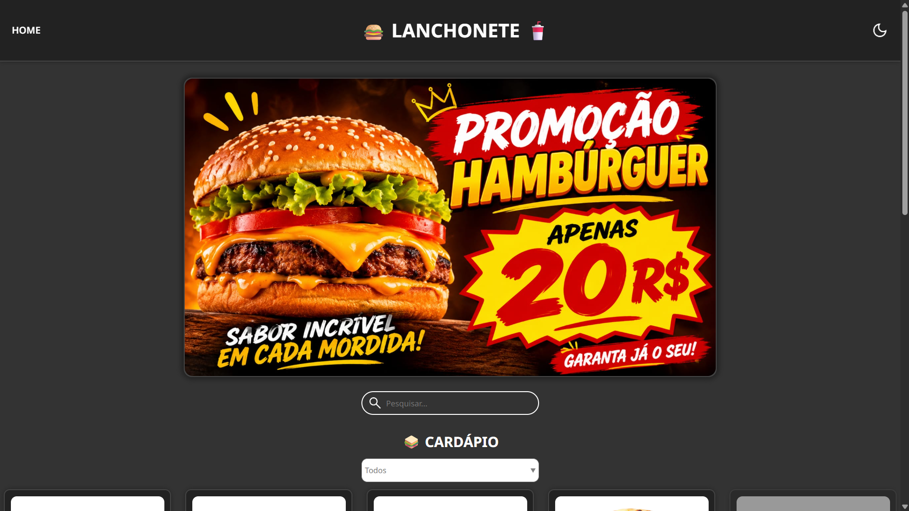

# TCC Lanchonete

Esse projeto de TCC foi construido em grupo com o objetivo de colocar em prática os conhecimentos adquiridos ao longo do curso de programação na escolinha digital da empresa Paranoá, juntamente com a DataWake.

## Sobre o site

Imagem da tela inicial

O principal objetivo do nosso site OnePage, em um cenário fictício, é que o cliente possa visualizar nosso cardápio e comprar os produtos de forma interativa.

- Nossa OnePage conta com um cabeçalho fixo que se mantém na mesma posição enquanto o usuário navega pelo site;

- Clicando no texto "HOME" no canto superior esquero do cabeçalho, o usuário é redirecionado automaticamente para o início da página;

- O usuário pode alternar entre os temas claro e escuro do site apenas clicando no ícone no canto superior direito do cabeçalho;

- Abaixo do cabeçalho, há um banner que troca de imagem automaticamente, mostrando os produtos que estão em promoção;

- Depois, há um campo onde o usuário pode pesquisar por um produto digitando o nome do produto ou categoria;

- Logo abaixo do campo de pesquisa, temos, finalmente, o cardápio. Aqui, o usuário visualiza todos os itens que nossa lanchonete oferece, podendo filtrar por categoria. Em cada item, temos a imagem, o nome, o preço, a categoria a disponibilidade e um botão para adicionar o produto ao carrinho;

- Caso exista algum produto no carrinho, é criada uma seção mostrando o item que está no carrinho. Aqui o usuário pode visualizar o preço do produto e alterar a quantidade dos produtos que ele escolheu ou remover algum item. *Obs: No carrinho, o preço do produto é multiplicado pela quantidade informada pelo usuário.*
Aqui, é feito o cálculo do preço total de todos os produtos que estão no carrinho;

- **A cereja do bolo:** Quando o usuário clica em comprar, são apresentados os seguintes itens: um alerta informando que a compra foi efetuada com sucesso, os produtos comprados, e o preço total. Após visualizar esse alerta, acontece uma "chuva de hambúrgueres" na tela, e é descontada a quantidade comprada da quantidade disponível do produto no cardápio;

- O próximo item que compõe a página, é uma seção com dois campos que o usuário deve preencher com nome e senha caso ele queira adicionar, apagar ou resetar os produtos do cardápio, desde que ele tenha essa permissão. Se os dados que ele preencher forem de um administrador, uma nova seção é criada perguntando o que ele deseja fazer. Essa seção é composta por dois textos: um mostrando a quantidade de produtos cadastrados e o outro mostrando o cálculo da média do preço de todos os produtos no cardápio. E quatro botões: um de adicionar produto, um de remover produto, um de resetar (voltar o cardápio ao seu estado original) e um de sair.

**Função dos 4 botões:**

- **Adicionar produto:** Ao clicar nesse botão, é mostrado um formulário que o administrador deve preencher para adicionar um novo produto.

- **Remover produto:** Quando pressionado, o administrador deve informar o nome do produto que deseja remover e confirmar se realmente deseja realizar essa ação.

- **Resetar:** Ao pressionar esse botão, os produtos do cardápio voltam ao estado original.

- **Sair:** Clicando nesse botão, a seção com os 4 botões "desaparece".

## Sobre o projeto

Esse projeto foi inteiramente construído com o **React**, onde, dentro dele, escrevemos nosso HTML, CSS e JavaScript.  

Ele serve para facilitar a criação de interfaces de usuário interativas e organizadas em aplicações web.  

No curso, aprendemos: 

- Componentização: É a divisão da tela em blocos independentes, facilitando a manutenção e evitando código duplicado. *Por exemplo: o botão, ele é criado apenas uma vez e é reutilizado nas outras telas*;

- Atualizações dinamicas: Quando os dados ou o estado de um componente mudam, o React atualiza apenas as partes necesárias da interface sem recarregar a página inteira. Por exemplo: no Instagram, quando um usuário curte uma foto, apenas o icone de coração muda (de preenchimento vazio para preenchimento em vermelho) e o resto da página permanece como estava, sem recarregar.